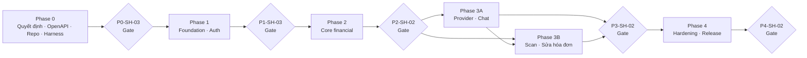

# Dependency Map
**Trạng thái:** Revision 3.2.1 (2026-11-20) – đã đồng bộ nguồn, trình nhóm review; chưa được nhóm duyệt. **80 task.** ID task xem `task-breakdown.md`; quyết định `D-xx` xem `review-plan-report.md` §6. Việc kiểm tra "không vòng phụ thuộc" chạy tự động (`review-plan-report.md` §4). Nguồn v1.1 đã được đối chiếu trực tiếp; V-01…V-08 có bằng chứng tại `review-plan-report.md` §9.

## 1. Mức Phase và cổng duyệt
Mỗi mũi tên đi qua một **gate do nhóm ký** (P0-SH-03, P1-SH-03, P2-SH-02, P3-SH-02, P4-SH-02).


## 2. Chuỗi Backend & Frontend song song
```mermaid
flowchart TB
  SRC[P0-SH-01 Review nguồn v1.1] --> OA[P0-SH-02 OpenAPI]
  DEC[D-05 Review mapping trước migration] --> DB[P1-BE-01 Schema / Migration]
  OA --> BE1[P1-BE-01 Schema + delta (sau khi duyệt)]
  OA --> FE4[P1-FE-04 API client + remember-me]
  BE1 --> BE3[P1-BE-03 Primitives + Idempotency] --> BE4[P1-BE-04 Auth]
  BE1 --> BE6[P1-BE-06 Provisioner] --> BE4
  FE1[P1-FE-01 Scaffold ECC] --> FE2[P1-FE-02 Tokens UI] --> FE3[P1-FE-03 Điều hướng] --> FE6[P1-FE-06 Auth UI]
  FE4 --> FE6
  BE4 --> G1{P1-SH-03}
  FE6 --> G1
  G1 --> C1[P2-BE-01 Category] --> T[P2-BE-03 Transaction]
  BE3 --> R[P2-BE-02 Domain rules] --> T
  T --> B[P2-BE-04 Budget]
  T --> S[P2-BE-06 Statistics]
  R --> J[P2-BE-05 Jar + khóa tuần tự]
  T --> J
  B --> D[P2-BE-07 Dashboard]
  J --> D
  S --> D
  D --> G2{P2-SH-02}
  G2 --> PR[P3-BE-01 AIProvider]
  G2 --> DR[P3-BE-02 Draft rules]
  PR --> CH[P3-BE-04 Chat + idempotency]
  DR --> CV[P3-BE-03 Conversation] --> CH
  CH --> DE[P3-BE-05 Draft endpoints] --> CA[P3-BE-06 Confirm-all]
  PR --> SC[P3-BE-07 Scan + hủy upload] --> IT[P3-BE-08 Món hàng · xác nhận · sửa hóa đơn] --> PV[P3-BE-09 Privacy]
  DE --> IT
  CA --> G3{P3-SH-02}
  PV --> G3
  G3 --> H[P4-BE-01…04 · P4-TD · P4-SH]
```

## 3. Phụ thuộc chéo nhánh (FE ↔ BE ↔ Test)
| FE task | Chờ BE/Shared (hoặc dùng mock MSW) | Ghi chú |
|---|---|---|
| P1-FE-04 API client | P0-SH-02 | Chỉ cần OpenAPI |
| P1-FE-06 Auth UI | P1-BE-04 (tích hợp thật); mock trước đó | P1-TD-01 cần cả hai |
| P2-FE-04…09 | P2-BE-03…07 | Tích hợp thật ở P2-SH-01 |
| P2-FE-09 Dashboard | P2-BE-05 (hũ ảnh hưởng số dư) | |
| P2-FE-05 Lịch sử (sửa hóa đơn) | P3-BE-08 | Nút "Sửa món hàng" bật ở Phase 3 (P3-FE-08) |
| P3-FE-03…05 | P3-BE-03…06 | Mock bằng fixtures AI |
| P3-FE-06…08 | P3-BE-07…08 | Mock bằng fixture hóa đơn |
| Mọi E2E (`*-TD-01`) | FE + BE của phase đó | |

## 4. Cổng quyết định → task bị chặn
Chỉ các D-xx loại ② có mặc định đề xuất, ③ hoãn được, ④ có phương án; **D-01 và D-04b không chặn Phase 0/1**.
| Quyết định | Chặn task |
|---|---|
| **V-01…V-08 đã đối chiếu; D-05 nhóm review trước migration** | P0-SH-01 review source evidence; P0-SH-02 sinh OpenAPI từ API v1.1; D-05 chỉ là gate nhóm trước schema/migration (P1-BE-01, P1-BE-03) |
| D-06 (**đã xử lý theo hợp đồng `PATCH /transactions/{transactionId}` của API v1.1**) | không chặn task nào |
| D-02 repo, D-03 phiên bản | P0-TD-01 → toàn bộ |
| D-04a CI | P0-TD-05 |
| D-04b hosting/vùng | **chỉ** P4-TD-02 |
| D-05 idempotency (14 cột đã có ở 6 bảng theo ERD v1.1; không thêm cột) | P1-BE-01, P1-BE-03 trước migration; không chặn OpenAPI |
| D-12a/D-12b xóa giao dịch/receipt child rows (hard/soft vẫn mở) | P1-BE-01, P2-BE-03 |
| D-12c xóa tài khoản (OQ-03) | không task nào (hoãn) |
| D-13a/b remember-me, token | P1-BE-04, P1-FE-04, P1-FE-06 |
| D-13c quên mật khẩu (OQ-02) | không task nào (hoãn) |
| D-14 danh mục mặc định | P1-BE-06, P2-BE-01 |
| D-15 quy ước hợp đồng | P0-SH-02, P1-BE-03, P1-FE-05 |
| D-16 thư viện FE & E2E | P0-TD-03, P0-TD-06, P1-FE-01, P2-FE-02 |
| D-09 future-date cutoff (OQ-10; chưa chốt) | không chặn; chỉ cần quyết định trước khi thêm validation/test về cutoff tương lai |
| D-07 số dư không âm (**đã duyệt theo PRD v1.1, không mở lại**) | quy tắc áp dụng ở P2-BE-02/03/05, P3-BE-05/06/08; không chặn quyết định nào |
| D-08 ngân sách theo tháng | P2-BE-04, P2-FE-06 |
| D-10 thống kê (**đã chốt theo PRD v1.1**) | không chặn; P2-BE-06/P2-FE-08 theo baseline chi tiêu 7 ngày |
| D-11 sửa/xóa hũ | P2-BE-09 (mặc định không làm) |
| D-17, D-18 | P3-BE-01, P3-BE-03, P3-BE-04 |
| D-19 | P3-BE-07, P3-FE-06 |
| D-20 | P3-BE-10, P4-TD-02 |
| D-21…D-24 (đề xuất tùy chọn ngoài phạm vi v1) | không task nào; chỉ khi nhóm mở change request |
| D-01 prototype | **không chặn**; chỉ kích hoạt "delta review" nếu có prototype mới |

## 5. Đường găng (theo task)
P0-SH-01 → P0-SH-02 → P0-TD-01 → P0-SH-03 (gate) → P1-BE-01 → P1-BE-03 → P1-BE-04 → P1-SH-03 (gate) → P2-BE-02 → P2-BE-03 → P2-BE-05 → P2-BE-07 → P2-SH-02 (gate) → P3-BE-01 → P3-BE-04 → P3-BE-05 → P3-BE-06 / P3-BE-07 → P3-BE-08 → P3-SH-02 (gate) → P4-TD-01 → P4-SH-02 (gate).
Rút ngắn: FE chạy song song bằng mock; chốt gói D-xx loại ② sớm (đặc biệt D-05, D-17, D-18); harness và fixtures sẵn trước tính năng.
