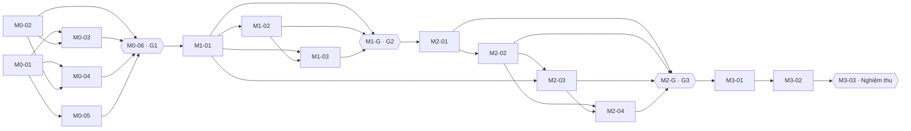

# Planning Revision 4.0-MVP — AI Smart Expense

| Thuộc tính | Giá trị |
|---|---|
| Trạng thái | Nhóm đã duyệt nội dung (2026-11-24); chữ ký chính thức tại Gate G1 |
| Thay thế cho thực thi | Planning Revision 3.2.2 (80 task). Bản gốc lưu nguyên vẹn ở `archive/revision-3.2.2/` (khớp `MANIFEST_SHA256.txt`) |
| Căn cứ | `docs/sources/*` v1.1 (không sửa) + `docs/change-requests/CR-01-mvp-scope.md` + `CR-02-opening-balance.md` |
| Quy mô | **18 task · 4 phase · 3 gate + nghiệm thu · 19 endpoint MVP · 23 AC** |

## 0. Thuật ngữ: ECC và kiến trúc frontend (S12)
Hai khái niệm khác nhau, **không đồng nhất**:

| Khái niệm | Là gì | Trạng thái |
|---|---|---|
| **ECC = Everything Claude Code** | Bộ công cụ riêng dành cho Claude Code (agents, rules, commands, hooks, skills), dùng trong quy trình làm việc của giảng viên | **Chưa cài** trong môi trường đã kiểm tra (2026-11-24: `~/.claude` không có `agents/`, `rules/`, `commands/`, hooks; repo không có `CLAUDE.md` hay `.claude/`). Revision 4.0-MVP **không** có task cài đặt hay cấu hình ECC; việc cài (nếu cần) do nhóm quyết định riêng |
| **Kiến trúc Rule/Store/Container/Presentational** | Kiến trúc frontend của ứng dụng AI Smart Expense, mô tả trong Solution Architecture v1.1 §5 và `frontend-plan.md` §2 | Đã có trong code: `src/rules`, `src/stores`, `features/*/containers`, `ui/` + `features/*/components`, ESLint ranh giới kiến trúc (`apps/mobile/eslint.config.js`) |

- Tài liệu Revision 3.2.2 (và tiêu đề Solution Architecture v1.1 §5, comment trong `apps/mobile/eslint.config.js`) dùng chữ "ECC" để chỉ kiến trúc Rule/Store/Container/Presentational. Các tài liệu đó **không được sửa nội dung gốc**; khi đọc, hiểu chữ "ECC" ở đó là kiến trúc frontend. Từ Revision 4.0, tài liệu mới chỉ dùng **"ECC"** cho Everything Claude Code và gọi kiến trúc bằng tên đầy đủ.
- Đổi comment trong code không thuộc phạm vi lượt tài liệu này.

## 1. Phạm vi và nguyên tắc
- Phạm vi: CR-01 §2. Hoãn/loại: CR-01 §3. Ngoại lệ so với nguồn: CR-01 §4 (E-01…E-11).
- Số dư: CR-02. Công thức **duy nhất** của MVP: `available_balance = opening_balance − Σ khoản chi đã xác nhận` (CR-02 §2). Không có thu nhập, hũ, ngân sách, thống kê đầy đủ, AI Chat backend, tài khoản demo.
- Giữ nguyên: D-05 (idempotency theo ERD), D-07 (không âm), D-12a/b (soft delete, giữ receipt), D-15 (không thêm mã lỗi), quy tắc AI Scan FR-11/FR-12.
- Không thêm task, endpoint, bảng ngoài danh sách dưới đây nếu chưa có change request.

### 1.1 Quyết định kỹ thuật đã chốt (áp dụng khi triển khai)
| Mã | Quyết định |
|---|---|
| QA / E-08 | Mật khẩu: scrypt N=2^15, r=8, p=1 (định dạng `scrypt$N$r$p$salt$hash`). M0-05 đo thời gian băm và bộ nhớ trên nền tảng thật. |
| QB | Refresh: xoay vòng; chỉ lưu SHA-256; token cũ bị dùng lại **sau** grace 10 giây ⇒ thu hồi **mọi phiên** của user; **trong** grace ⇒ chỉ trả 401, **không cấp token, không tạo phiên** (grace không phải cơ chế replay). Áp dụng cả token đã thu hồi do logout. |
| QC / E-07 | `ai_drafts.category_id` FK đơn; kiểm category thuộc đúng user và `type = EXPENSE` trong cùng DB transaction ở PATCH draft và confirm. |
| QD | `RECEIPT_MAX_BYTES = 4194304` (4 MB, sau nén phía client); throttle auth 10 lần/phút/IP; scan 20 lần/giờ/user. |
| QE | 10 danh mục chi mặc định: Ăn uống, Di chuyển, Mua sắm, Hóa đơn & Tiện ích, Nhà ở, Giải trí, Sức khỏe, Giáo dục, Gia đình, Khác. (5 danh mục thu đã có trong code tiếp tục được tạo nhưng không hiển thị trong MVP.) |
| K3 | Guard tra phiên trong DB ở mọi request (logout/refresh có hiệu lực ngay). |
| K4 | Chỉ giữ CHECK tương ứng bất biến có trong ERD/API/CR (§7.2). |
| K6 | Idempotency-Key client 8–128 ký tự `[A-Za-z0-9_-]`; giá trị lưu DB có namespace thao tác (ERD §2). |
| K10b | Migration do **Prisma Migrate** quản lý; SQL bổ sung (CHECK) đặt trong file migration do Prisma tạo; drift phải rỗng (§7). |
| Q1 / E-04 | Expo Web ẩn "Ghi nhớ đăng nhập". |
| C1–C3 | CR-02 §3. |
| C7 / E-03 | E2E bằng Playwright trên Expo Web. |

## 2. Danh sách 18 task
Size quy đổi: S = 1, M = 2, L = 4. Mỗi task phải đạt DoD-T (`definition-of-done.md`).

### Phase M0 — Nền tảng và spike triển khai
| ID | Task | Size | Phụ thuộc | Nội dung và tiêu chí hoàn thành | Test |
|---|---|---|---|---|---|
| M0-01 | Cài đặt, lockfile, build | M | — | `pnpm install` tạo `pnpm-lock.yaml`; xóa `node_modules` rồi `pnpm install --frozen-lockfile` thành công; `npx expo install --check`; `nest build`; `expo export --platform web`; điền `docs/stack-lock.md`. **Không commit/push** (nhóm tự commit) | Lệnh build/smoke |
| M0-02 | Hợp đồng MVP | M | — | `openapi.yaml`: thêm `PUT /users/me/opening-balance`, 2 trường Dashboard; gắn `x-mvp: core` cho 19 endpoint, `x-mvp: deferred` cho 26; `check-openapi.mjs` kiểm theo danh sách MVP (không cứng 44/6); `contract-changelog.md` ghi CR-01/CR-02; sinh lại types | Contract check |
| M0-03 | Schema và migration (Prisma Migrate) | S | M0-01, M0-02 | Quy trình §7: baseline do Prisma tạo + CHECK theo K4; migration bổ sung `cr02_opening_balance`; `prisma validate`; drift rỗng | IT-SCHEMA |
| M0-04 | Chạy và sửa test nền BE + FE | L | M0-01, M0-02 | Unit/integration BE (Auth, User, Envelope, Contract, authz nền); unit FE, ESLint ranh giới; Expo Web local + 1 Playwright smoke đăng nhập; ẩn "Ghi nhớ đăng nhập" trên web | UT-*, IT-AUTH, IT-AUTH-REFRESH, IT-USER, IT-ENVELOPE, IT-CONTRACT, UT-FE-*, ESLint |
| M0-05 | Spike triển khai | M | M0-01 | Checklist §8. Script tạm trong `scripts/spike/` (không phải code sản phẩm, xóa sau khi có kết luận); **Supabase thử nghiệm riêng**, không dùng DB production; kết luận trong `docs/deploy-spike.md` | Log spike |
| M0-06 | CI xanh + **Gate G1** | S | M0-02…M0-05 | CI: lint → typecheck → unit → integration → contract → drift; traceability cập nhật; nhóm ký `docs/gates/G1.md` | CI run |

### Phase M1 — Số dư và khoản chi
| ID | Task | Size | Phụ thuộc | Nội dung và tiêu chí hoàn thành | Test |
|---|---|---|---|---|---|
| M1-01 | BE: module số dư | M | G1 | Công thức CR-02 §2; trạng thái thiết lập; khóa sau khoản chi đầu tiên; `BalanceGuard` dùng chung (khóa `users … FOR UPDATE`, tính số dư dự kiến, từ chối và rollback); `PUT /users/me/opening-balance`; câu "Số dư không đủ" | UT-OPEN-VALUE, UT-BAL, IT-OPEN-BAL |
| M1-02 | BE: khoản chi + Dashboard | M | M1-01 | `GET /categories` (EXPENSE); `POST /transactions` (EXPENSE; INCOME → 422; Idempotency-Key); `GET /transactions` (tháng, phân trang); `GET /transactions/{transactionId}` (kèm receipt); `GET /dashboard` | IT-TX, IT-DASH, IT-IDEM, IT-BAL-GUARD (1a, 1b, 2, 12), IT-CONC-BAL |
| M1-03 | FE: số dư và khoản chi | L | M1-01, M1-02 (hoặc MSW) | Màn thiết lập số dư; Dashboard; thêm khoản chi (2 thông báo CR-02); danh sách + chi tiết; ẩn tab ngoài MVP; Rule gợi ý số dư; MSW handler cho endpoint M1 | UT-FE-BAL-HINT, IT-FE-CONTAINER (M1) |
| M1-G | Xác minh tích hợp + **Gate G2** | S | M1-01…M1-03 | Phản hồi BE và mock MSW khớp OpenAPI cho endpoint M1; nhóm ký `G2.md` | IT-CONTRACT, IT-CONTRACT-MOCK |

### Phase M2 — AI Scan
| ID | Task | Size | Phụ thuộc | Nội dung và tiêu chí hoàn thành | Test |
|---|---|---|---|---|---|
| M2-01 | AIProvider cho hóa đơn | M | G2, kết luận M0-05 ĐẠT | Interface `analyzeReceipt`; adapter Claude (model, timeout, retry 1 từ config); FakeProvider; validate schema đầu ra (dữ liệu không tin cậy); fixture đối kháng hóa đơn | IT-PROVIDER-MAP, IT-AI-ADV |
| M2-02 | BE: tải ảnh, tạo nháp | M | M2-01 | `POST /ai/receipts/scan`: MIME + magic bytes + ≤ 4 MB + giải mã được; Idempotency (SHA-256 byte ảnh); 1 batch + 1 draft + items trong 1 DB tx; hủy buffer khi thành công/lỗi/hủy; không lưu ảnh, không log ảnh; throttle 20/giờ/user | IT-SCAN, IT-SCAN-IDEM, IT-PRIV, IT-SCAN-FAIL, IT-SCAN-ABORT |
| M2-03 | BE: sửa nháp và xác nhận | L | M2-02, M1-01 | `GET`/`PATCH /ai/drafts/{draftId}`; `POST /ai/drafts/{draftId}/items`, `PATCH`/`DELETE /ai/draft-items/{itemId}`; đối soát tổng; kiểm category đúng user trong tx (QC); `POST …/confirm` qua `BalanceGuard`: 1 EXPENSE + receipt + items trong 1 tx; bị từ chối giữ nháp; Idempotency-Key | UT-DRAFT, UT-RECON, IT-SCAN-CONFIRM, IT-DRAFT-AUTHZ, IT-BAL-GUARD (13), IT-OPEN-BAL (7) |
| M2-04 | FE: luồng AI Scan | L | M2-02, M2-03 (hoặc MSW) | Chọn ảnh, nén (cạnh dài ≤ 1600 px, JPEG), tải lên, trình sửa nháp, banner lệch tổng, **thiết lập số dư ngay trong trình sửa nháp (hộp thoại, không rời màn)**, xác nhận, làm mới Dashboard, dọn ảnh khỏi bộ nhớ/cache | UT-FE-DRAFT, UT-FE-RECON, IT-FE-CONTAINER (M2) |
| M2-G | Xác minh hợp đồng AI + **Gate G3** | S | M2-01…M2-04 | Phản hồi BE và mock khớp OpenAPI cho endpoint AI; nhóm ký `G3.md` | IT-CONTRACT, IT-CONTRACT-MOCK |

### Phase M3 — Triển khai và nghiệm thu
| ID | Task | Size | Phụ thuộc | Nội dung và tiêu chí hoàn thành | Test |
|---|---|---|---|---|---|
| M3-01 | Deploy production + hardening tối thiểu | M | G3 | Đọc `_prisma_migrations` trên DB production **trước**, rồi `prisma migrate deploy`; deploy API + Expo Web (URL công khai); secret chỉ trong dashboard nền tảng; CORS chỉ origin web; throttle auth/scan; security header; quét secret repo và bundle | IT-SEC |
| M3-02 | E2E và regression trên URL thật | M | M3-01 | Playwright E2E-01, 02, 09, 10, 13; chạy lại IT-AUTHZ (19 endpoint), IT-BAL-GUARD, IT-CONC-BAL, IT-SCAN-IDEM, IT-PRIV | E2E + regression |
| M3-03 | Runbook + nghiệm thu | S | M3-02 | `docs/runbook.md`: tự đăng ký (không tài khoản demo), giới hạn đã biết (CR-01 §5), checklist UX tối thiểu; nhóm ký `nghiem-thu.md` | Checklist |

**Tổng: 18 task · 39 điểm** (M0: 12, M1: 9, M2: 13, M3: 5).

## 3. Phụ thuộc và gate

- Task phase sau chỉ bắt đầu khi gate phase trước được **nhóm** ký. FE được làm trước bằng MSW trong cùng phase.
- M2-01 cần kết luận M0-05 = ĐẠT. Nếu KHÔNG ĐẠT: dừng sau M0, nhóm chọn nền tảng khác (không chọn trước).

| Gate | Điều kiện ký |
|---|---|
| G1 (M0-06) | M0-01…05 đạt DoD-T; CI xanh; drift rỗng; spike ĐẠT; CR-01/CR-02 được ký |
| G2 (M1-G) | AC-04′…07′, 10′, 27…34 có test xanh; regression G1 xanh |
| G3 (M2-G) | AC-21…26′, 35 có test xanh; IT-PRIV xanh; regression G1–G2 xanh |
| Nghiệm thu (M3-03) | URL công khai chạy; E2E xanh trên URL thật; runbook; giới hạn đã biết được ghi |

## 4. Endpoint
### 4.1 19 endpoint MVP
| # | Endpoint | Trạng thái code | Task |
|---|---|---|---|
| 1 | `POST /auth/register` | Có | M0-04 |
| 2 | `POST /auth/login` | Có | M0-04 |
| 3 | `POST /auth/refresh` | Có | M0-04 |
| 4 | `POST /auth/logout` | Có | M0-04 |
| 5 | `GET /users/me` | Có | M0-04 |
| 6 | `PATCH /users/me` | Có (không làm màn hình) | M0-04 |
| 7 | `PUT /users/me/opening-balance` | **Mới (CR-02)** | M1-01 |
| 8 | `GET /dashboard` | Mới | M1-02 |
| 9 | `GET /categories` | Mới | M1-02 |
| 10 | `POST /transactions` | Mới | M1-02 |
| 11 | `GET /transactions` | Mới | M1-02 |
| 12 | `GET /transactions/{transactionId}` | Mới | M1-02 |
| 13 | `POST /ai/receipts/scan` | Mới | M2-02 |
| 14 | `GET /ai/drafts/{draftId}` | Mới | M2-03 |
| 15 | `PATCH /ai/drafts/{draftId}` | Mới | M2-03 |
| 16 | `POST /ai/drafts/{draftId}/items` | Mới | M2-03 |
| 17 | `PATCH /ai/draft-items/{itemId}` | Mới | M2-03 |
| 18 | `DELETE /ai/draft-items/{itemId}` | Mới | M2-03 |
| 19 | `POST /ai/drafts/{draftId}/confirm` | Mới | M2-03 |

Cần Bearer: 15 endpoint (tất cả trừ #1–#4). `/health` là endpoint vận hành, nằm ngoài hợp đồng.

### 4.2 26 endpoint hoãn (giữ trong hợp đồng, `x-mvp: deferred`)
`POST /categories` · `PATCH`, `DELETE /transactions/{transactionId}` · 4 endpoint `/budgets` · 6 endpoint `/saving-jars` · 3 endpoint `/statistics` · `POST`, `GET /ai/conversations` · `GET`, `PATCH`, `DELETE /ai/conversations/{conversationId}` · `POST`, `GET …/messages` · `GET …/draft-batches` · `POST /ai/drafts/{draftId}/cancel` · `POST /ai/draft-batches/{batchId}/confirm-all`.

Kiểm đếm: 18 endpoint v1.1 dùng + 26 hoãn = 44 (API v1.1); + 1 CR-02 = **45** trong hợp đồng.

## 5. Acceptance criteria MVP (23)
| AC | Nội dung MVP | Nguồn | Task | Test |
|---|---|---|---|---|
| AC-01 | Đăng ký thành công với dữ liệu hợp lệ, email chưa dùng | PRD | M0-04 | IT-AUTH, E2E-01 |
| AC-02 | Từ chối email sai/trùng, mật khẩu < 8 ký tự, thiếu đồng ý điều khoản | PRD | M0-04 | IT-AUTH, UT-VALID, UT-FE-VALID, E2E-01 |
| AC-03′ | Đăng nhập/đăng xuất hoạt động; sai thông tin báo lỗi; trên web không có "Ghi nhớ đăng nhập" (CR-01 E-04) | PRD + CR-01 | M0-04 | IT-AUTH, IT-AUTH-REFRESH, UT-FE-SESSION, E2E-01 |
| AC-04′ | Dashboard: số dư = opening − Σ chi; trạng thái thiết lập; chi tiêu tháng; 5 khoản gần nhất | PRD + CR-02 | M1-02, M1-03 | IT-DASH, IT-FE-CONTAINER |
| AC-05′ | Tạo khoản chi hợp lệ chỉ khi đạt CR-02 | PRD + CR-02 | M1-02, M1-03 | IT-TX, IT-BAL-GUARD, E2E-02 |
| AC-06′ | Số tiền ≤ 0, thiếu danh mục, ngày sai, không đủ số dư, `type=INCOME` ⇒ từ chối, không lưu gì | PRD + CR-01 | M1-02 | IT-TX, UT-MONEY, IT-BAL-GUARD |
| AC-07′ | Xem danh mục chi mặc định (10 mục QE) | PRD + CR-01 | M1-02 | IT-CAT-PROV, IT-TX |
| AC-10′ | Xem danh sách khoản chi theo tháng và chi tiết (kèm món nếu là hóa đơn) | PRD + CR-01 | M1-02, M1-03 | IT-TX, IT-AUTHZ, E2E-02 |
| AC-21 | AI Scan đọc tên món, giá, tổng khi đọc được | PRD | M2-01, M2-02 | IT-SCAN, E2E-09 |
| AC-22 | Thêm/sửa/xóa món; ô không đọc được được đánh dấu | PRD | M2-03, M2-04 | IT-SCAN, UT-FE-DRAFT, E2E-09 |
| AC-23′ | Lệch tổng món và tổng hóa đơn chặn xác nhận nháp (phần sửa hóa đơn đã xác nhận: hoãn) | PRD + CR-01 | M2-03, M2-04 | UT-RECON, UT-FE-RECON, IT-SCAN-CONFIRM, E2E-09 |
| AC-24 | Ảnh hóa đơn chỉ tạm thời, được dọn; không lưu ảnh gốc | PRD | M2-02 | IT-PRIV, IT-SCAN-FAIL, IT-SCAN-ABORT, E2E-10 |
| AC-25 | Không tự chọn danh mục, không tách thuế/phí/giảm giá | PRD | M2-01, M2-03 | IT-SCAN |
| AC-26′ | Xác nhận hóa đơn tạo 1 khoản chi + các món chỉ khi tổng khớp **và** đạt CR-02; màn hình cập nhật sau khi lưu thành công | PRD + CR-02 | M2-03, M2-04 | IT-SCAN-CONFIRM, IT-BAL-GUARD, E2E-09 |
| AC-27…AC-35 | Số dư ban đầu (CR-02 §4) | CR-02 | M1-01…M1-03, M2-03, M2-04 | UT-OPEN-VALUE, UT-BAL, IT-OPEN-BAL, IT-BAL-GUARD, IT-CONC-BAL, E2E-02, E2E-09, E2E-13 |

**Hoãn (CR-01):** AC-08, 09, 11, 12, 13, 14, 15, 16, 17, 18, 19, 20; phần tạo danh mục của AC-07; phần sửa/xóa của AC-10; phần sửa hóa đơn đã xác nhận của AC-23.
**NFR:** SEC, INT, PRI, USA giữ trong phạm vi MVP; PERF thu gọn thành timeout AI + trạng thái loading/error.

## 6. Test bắt buộc
| Test | Phủ | Task |
|---|---|---|
| UT-MONEY, UT-DATE, UT-IDEM, UT-HASH, UT-VALID, UT-REDACT, UT-CAT-NORM | Nguyên thủy BE | M0-04 |
| UT-FE-MONEY, UT-FE-VALID, UT-FE-SESSION, UT-FE-HTTP, ESLint ranh giới kiến trúc Rule/Store/Container/Presentational | Nguyên thủy FE | M0-04 |
| IT-SCHEMA | Ràng buộc DB theo §7.2 (gồm `opening_balance < 0` bị chặn) | M0-03 |
| IT-AUTH | AC-01…03′ | M0-04 |
| **IT-AUTH-REFRESH** | (1) 5 refresh song song cùng token → đúng 1 thành công, không thu hồi toàn bộ; (2) dùng lại token cũ **trong** grace, lặp nhiều lần → luôn 401, không phiên mới, không token mới; (3) dùng lại **sau** grace → 401 + mọi phiên bị thu hồi; (4) logout → refresh bằng token đó → 401; sau grace → thu hồi mọi phiên; (5) access token của phiên đã xoay vòng → 401 | M0-04 |
| IT-USER, IT-ENVELOPE | `/users/me`, envelope, request_id, JSON hỏng | M0-04 |
| UT-OPEN-VALUE, UT-BAL, IT-OPEN-BAL | CR-02 §6 | M1-01, M2-03 |
| IT-TX, IT-DASH, IT-IDEM, IT-CAT-PROV | AC-04′…07′, 10′ | M1-02 |
| IT-BAL-GUARD | Ca 1a, 1b, 2, 12 (M1-02); ca 13 (M2-03) | M1-02, M2-03 |
| IT-CONC-BAL | 2 khoản chi song song vượt số dư → đúng 1 được lưu | M1-02, M3-02 |
| UT-FE-BAL-HINT, IT-FE-CONTAINER (M1) | Container số dư/khoản chi với MSW: loading, error, 2 thông báo CR-02 | M1-03 |
| IT-PROVIDER-MAP, IT-AI-ADV | Ánh xạ lỗi provider; prompt injection trên ảnh hóa đơn không làm tự xác nhận hay tự chọn danh mục | M2-01 |
| IT-SCAN, IT-SCAN-IDEM | AC-21, 22, 25; cùng key + cùng ảnh → kết quả cũ; cùng key + ảnh khác → 409 | M2-02, M2-03 |
| IT-PRIV, IT-SCAN-FAIL, IT-SCAN-ABORT | Không còn byte ảnh trong DB/log/thư mục tạm sau thành công, lỗi provider, ảnh hỏng, hủy upload | M2-02 |
| UT-DRAFT, UT-RECON, IT-SCAN-CONFIRM | Đối soát, xác nhận nguyên tử | M2-03 |
| **IT-DRAFT-AUTHZ** (QC) | User B: đọc/sửa/xác nhận nháp của A → 404; A gán `category_id` của B vào nháp (PATCH) hoặc xác nhận với category đó → 422, không tạo bản ghi | M2-03 |
| UT-FE-DRAFT, UT-FE-RECON, IT-FE-CONTAINER (M2) | Trình sửa nháp, banner lệch tổng, hộp thoại thiết lập số dư | M2-04 |
| IT-CONTRACT, IT-CONTRACT-MOCK | Phản hồi BE **và** mock MSW khớp OpenAPI | M0-04, M1-G, M2-G |
| **IT-SEC** | Không lộ stack/secret/đường dẫn; security header; auth > 10/phút/IP → 429; scan > 20/giờ/user → 429 (suite chạy với throttle **bật**) | M3-01 |
| IT-AUTHZ | 15 endpoint cần Bearer: không token → 401, token hết hạn → 401, tài nguyên user khác → 404, `user_id` giả bị bỏ qua | M3-02 |
| E2E-01 | Đăng ký (có ca email trùng, mật khẩu ngắn, thiếu đồng ý) → đăng nhập → kiểm "Ghi nhớ đăng nhập" bị ẩn → đăng xuất | M0-04 (smoke), M3-02 |
| E2E-02 | Chưa thiết lập → thêm chi (thông báo OB-6) → thiết lập 0 → thêm chi ("Số dư không đủ") → sửa 100.000 → chi 100.000 (số dư 0) → chi 1.000 bị chặn | M3-02 |
| E2E-09 | Quét → lệch tổng → sửa → chọn danh mục → xác nhận khi chưa thiết lập bị chặn → thiết lập trong hộp thoại → xác nhận thành công → số dư ban đầu bị khóa | M3-02 |
| E2E-10 | Không còn ảnh sau quét/hủy/lỗi | M3-02 |
| E2E-13 | Nhập số dư âm bị từ chối | M3-02 |

## 7. Migration (K10b, XN-1)
### 7.1 Quy trình
| Bước | Việc | Ghi chú |
|---|---|---|
| 1 | Thu thập bằng chứng XN-1: trên **mỗi** DB thật của dự án (local của từng thành viên nếu dùng chung, Supabase) chạy `SELECT migration_name, checksum FROM _prisma_migrations` | DB thử nghiệm của Claude (`ase_verify`, `ase_zipcheck`) chạy SQL bằng `psql`, **không** qua Prisma ⇒ không phải bằng chứng cho DB thật |
| 2 | Sinh baseline bằng Prisma: `prisma migrate diff --from-empty --to-schema-datamodel prisma/schema.prisma --script` (trên schema **chưa** có cột CR-02), so cấu trúc với baseline hiện có | Baseline hiện tại là bản viết tay |
| 3a | **Nếu có bằng chứng** chưa DB thật nào áp dụng baseline | Thay baseline viết tay bằng baseline do Prisma tạo + khối CHECK §7.2 (theo cách "customize migration" của Prisma: `--create-only` rồi bổ sung SQL) |
| 3b | **Nếu** có DB thật đã áp dụng baseline (có dòng trong `_prisma_migrations`) | **Không** sửa file baseline (sửa sẽ lệch checksum). Giữ nguyên, kiểm drift rỗng, ghi ngoại lệ vào `decisions.md`; CHECK bị loại theo K4 được bỏ bằng migration bổ sung |
| 3c | **Nếu không có bằng chứng** | Không kết luận; dừng M0-03, báo nhóm |
| 4 | Thêm 2 cột vào `schema.prisma`; `prisma migrate dev --create-only --name cr02_opening_balance`; thêm `CHECK (opening_balance >= 0)` vào file vừa tạo; áp dụng lên DB test | Migration bổ sung, quản lý bởi Prisma |
| 5 | `prisma migrate diff --from-migrations … --to-schema-datamodel … --exit-code` rỗng; IT-SCHEMA xanh | Bắt buộc trong CI |
| 6 | Production (M3-01): đọc `_prisma_migrations` → `prisma migrate deploy` qua `DIRECT_URL` | Không chạy `migrate dev` trên production |

### 7.2 CHECK constraint (K4: chỉ bất biến có trong tài liệu)
| Giữ | Căn cứ |
|---|---|
| `amount > 0`: `transactions`, `jar_transactions`, `receipt_items`; `limit_amount > 0`; `target_amount > 0` | ERD §3.4–3.7, §3.14 "CHECK > 0" |
| `amount IS NULL OR amount > 0`: `ai_drafts`, `ai_draft_items` | ERD §3.11–3.12 "if set must be > 0" |
| `EXTRACT(DAY FROM month_start) = 1` | ERD §3.5 "first day of month" |
| Cặp key/hash idempotency cùng NULL hoặc cùng có giá trị (7 cặp) | ERD §2, §3.x: replay cần hash lưu kèm key; thiếu một bên thì không quyết định được REPLAY/CONFLICT |
| `transaction_id IS NULL OR status = 'CONFIRMED'` trên `ai_drafts` | ERD §3.11: nháp chỉ trỏ tới giao dịch khi đã xác nhận |
| `source_type <> 'AI_SCAN' OR conversation_id IS NULL` | ERD §3.10 "null for standalone AI Scan" |
| `opening_balance >= 0` | CR-02 OB-2 |

| Loại bỏ (khỏi baseline mới hoặc bằng migration bổ sung) | Lý do |
|---|---|
| 5 CHECK định dạng hex của hash (`auth_sessions`, `transactions`, `saving_jars`, `jar_transactions`, `ai_messages`) | Kiểm định dạng, không phải bất biến dữ liệu; `CHAR(64)` đã đủ |
| `ai_messages`: key chỉ cho role USER | ERD chỉ nói tin nhắn assistant "không cần" key, không cấm |

Kết quả: 18 CHECK (17 cũ được giữ + 1 của CR-02). Test SQL `it-schema.sql` hiện có không phụ thuộc CHECK bị loại.

## 8. Spike triển khai (M0-05) — checklist
Thực hiện trên máy có mạng do thành viên nhóm chạy (môi trường của Claude không có mạng, không có công cụ Vercel/Supabase). **Không gửi secret qua chat.**

| # | Kiểm tra | Tiêu chí ĐẠT |
|---|---|---|
| 1 | API NestJS chạy trên nền tảng được thử (Vercel, Fluid compute bật) | `/api/v1/health` trả 200 qua HTTPS |
| 2 | Prisma ↔ Supabase **thử nghiệm**: `DATABASE_URL` qua pooler (`pgbouncer=true`), `DIRECT_URL` cho migrate | Truy vấn thành công; đo cold start |
| 3 | Upload multipart ảnh 4 MB và 5 MB | 4 MB qua; 5 MB bị từ chối có kiểm soát (lỗi envelope, không crash) |
| 4 | Script tạm gọi Claude Vision **thật** với ảnh hóa đơn tự tạo | Trả JSON đọc được; ghi thời gian; nằm trong thời gian tối đa của function |
| 5 | scrypt (QA) | Ghi thời gian băm/so khớp và bộ nhớ (~32 MiB/lần) trên nền tảng thật; không lỗi `maxmem` |
| 6 | Expo Web tĩnh | `expo export --platform web` deploy, mở được trên máy khác; gọi API qua CORS |
| 7 | Dọn dẹp | Xóa `scripts/spike/`; xóa project Supabase thử (hoặc giữ làm môi trường test, ghi rõ) |

Kết luận ghi ở `docs/deploy-spike.md`: ĐẠT / KHÔNG ĐẠT, bằng chứng (không chứa secret), số đo.

## 9. Ánh xạ 80 task cũ (Revision 3.2.2)
| Task cũ | Trạng thái | Task mới | Phần hoãn |
|---|---|---|---|
| P0-SH-01 | Gộp | M0-02 | — |
| P0-SH-02 | Gộp | M0-02 | — |
| P0-TD-01 | Giữ | M0-01 | — |
| P0-TD-02 | Gộp | M0-04 | — |
| P0-TD-03 | Gộp | M0-04 | — |
| P0-TD-04 | Gộp | M0-06 | Fixture chat |
| P0-TD-05 | Gộp | M0-06 | — |
| P0-TD-06 | Gộp | M0-04 | Maestro (E-03) |
| P0-SH-03 | Gộp | M0-06 | — |
| P1-BE-01 | Giữ | M0-03 | — |
| P1-BE-02…P1-BE-06 (5) | Gộp | M0-04 | — |
| P1-SH-01 | Gộp | M0-04 | — |
| P1-FE-01…P1-FE-06 (6) | Gộp | M0-04 | Remember-me trên web (E-04) |
| P1-TD-01 | Gộp | M3-02 | Remember-me |
| P1-SH-02 | Gộp | M0-04 | — |
| P1-SH-03 | Gộp | M0-06 | — |
| P2-BE-01 | Thu gọn | M1-02 | Tạo danh mục |
| P2-BE-02 | Thu gọn | M1-01 | Thu nhập, hũ, ngân sách, thống kê |
| P2-BE-03 | Thu gọn | M1-02 | Thu nhập, sửa, xóa |
| P2-BE-04 | **Hoãn** | — | Ngân sách |
| P2-BE-05 | **Hoãn** | — | Hũ |
| P2-BE-06 | **Hoãn** | — | Thống kê |
| P2-BE-07 | Thu gọn | M1-02 | Cảnh báo ngân sách |
| P2-BE-08 | **Hoãn** | — | Hiệu năng |
| P2-BE-09 | **Hoãn** (cổng D-11) | — | — |
| P2-FE-01 | Gộp | M1-03 | — |
| P2-FE-02 | Gộp | M1-03 | — |
| P2-FE-03 | **Hoãn** | — | Màn danh mục |
| P2-FE-04 | Thu gọn | M1-03 | Thu nhập |
| P2-FE-05 | Thu gọn | M1-03 | Sửa, xóa |
| P2-FE-06 | **Hoãn** | — | Ngân sách |
| P2-FE-07 | **Hoãn** | — | Hũ |
| P2-FE-08 | **Hoãn** | — | Thống kê |
| P2-FE-09 | Gộp | M1-03 | — |
| P2-FE-10 | Gộp (phần có sẵn) | M0-04 | Sửa hồ sơ |
| P2-TD-01 | Thu gọn | M3-02 | E2E-03, 04, 05, 11 |
| P2-SH-01 | Gộp | M1-G | — |
| P2-SH-02 | Gộp | M1-G | — |
| P3-BE-01 | Thu gọn | M2-01 | `parseTransactions` |
| P3-BE-02 | Gộp | M2-03 | Confirm-all |
| P3-BE-03 | **Hoãn** | — | AI Chat |
| P3-BE-04 | **Hoãn** | — | AI Chat |
| P3-BE-05 | Thu gọn | M2-03 | Cancel |
| P3-BE-06 | **Hoãn** | — | Confirm-all |
| P3-BE-07 | Giữ | M2-02 | — |
| P3-BE-08 | Thu gọn | M2-03 | Sửa hóa đơn đã xác nhận |
| P3-BE-09 | Gộp | M2-02 | — |
| P3-BE-10 | **Hoãn** (cổng D-20) | — | — |
| P3-FE-01 | Gộp | M2-04 | — |
| P3-FE-02 | Thu gọn | M2-04 | AI hub đầy đủ |
| P3-FE-03 | **Hoãn** | — | AI Chat |
| P3-FE-04 | **Hoãn** | — | Confirm-all |
| P3-FE-05 | **Hoãn** | — | Hội thoại |
| P3-FE-06 | Giữ | M2-04 | — |
| P3-FE-07 | Giữ | M2-04 | — |
| P3-FE-08 | Thu gọn | M2-04 | Sửa hóa đơn đã xác nhận |
| P3-TD-01 | Thu gọn | M3-02 | E2E-06, 07, 08, 12 |
| P3-TD-02 | Thu gọn | M2-01 | Đối kháng cho Chat |
| P3-TD-03 | Gộp | M0-05 | — |
| P3-SH-01 | Gộp | M2-G | — |
| P3-SH-02 | Gộp | M2-G | — |
| P4-BE-01 | Thu gọn | M3-01 | Throttle AI Chat |
| P4-BE-02 | Thu gọn | M3-02 | Endpoint hoãn |
| P4-BE-03 | Thu gọn | M3-02 | Hũ, confirm-all |
| P4-BE-04 | **Hoãn** | — | Hiệu năng |
| P4-FE-01 | Thu gọn | M3-03 (checklist) | Dark mode, cỡ chữ lớn |
| P4-FE-02 | Gộp | M3-01 | — |
| P4-TD-01 | Thu gọn | M3-02 | Làn Android/iOS native |
| P4-TD-02 | Thu gọn | M0-05, M3-01 | Backup/restore (D-20), môi trường thứ 3 |
| P4-SH-01 | **Loại khỏi MVP** | M3-03 (chỉ runbook) | Seed/tài khoản demo |
| P4-SH-02 | Gộp | M3-03 | — |

**Kiểm đếm:** 62 task gộp/giữ/thu gọn + 18 hoãn/loại (17 hoãn + 1 loại) = **80**.

## 10. Rủi ro MVP
| ID | Rủi ro | Giảm thiểu | Task |
|---|---|---|---|
| R-M1 | Code NestJS/Expo chưa từng được build; thư viện thật khác giả định | M0-01, M0-04 làm sớm | M0 |
| R-M2 | Baseline viết tay lệch Prisma | Quy trình §7; drift trong CI | M0-03 |
| R-M3 | Nền tảng serverless không đáp ứng (body, thời gian, cold start, Prisma) | Spike M0-05 trước khi làm tính năng | M0-05 |
| R-M4 | Chi phí Claude khi công khai URL | Hạn mức chi tiêu trong Console; throttle 20/giờ/user | M0-05, M3-01 |
| R-M5 | Nháp bị bỏ lại tích tụ trong DB (không có job retention; tải lại trang mất khả năng tiếp tục) | Ghi giới hạn đã biết; job retention D-20 hoãn; ảnh không lưu nên chỉ tốn vài dòng dữ liệu | M3-03 |
| R-M6 | Người dùng bị kẹt khi chi hết hoặc nhập nhầm | Giới hạn đã biết (CR-01 §5) | M3-03 |
| R-M7 | Bản web mất phiên khi tải lại trang | Giới hạn đã biết (E-04) | M3-03 |
| R-M8 | Grace 10 giây bị lợi dụng để replay | IT-AUTH-REFRESH ca (2): trong grace luôn 401, không cấp token | M0-04 |

## 11. Truy vết các điểm S1–S12 của lượt rà soát
| Điểm | Xử lý tại |
|---|---|
| S1 (18 hoãn/loại) | §9 |
| S2 (đoạn bị thay thế) | CR-02 §5 |
| S3 (ngoại lệ nguồn) | CR-01 §4 E-01…E-04 |
| S4 (M0-02 → M0-04) | §2, §3 |
| S5 (spike) | §8, M0-05 |
| S6 (nháp khi tải lại) | CR-01 §5 mục 3, R-M5, M2-04 |
| S7 (IT-SEC) | §6, M3-01 |
| S8 (IT-SCAN-FAIL/ABORT, IT-AI-ADV) | §6, M2-01, M2-02 |
| S9 (test FE, mock) | §6, M1-03, M2-04, M1-G, M2-G |
| S10 (E2E-01) | §6 |
| S11 (AC-03′) | §5 |
| S12 (ECC = Everything Claude Code; kiến trúc Rule/Store/Container/Presentational là khái niệm riêng) | §0 |
