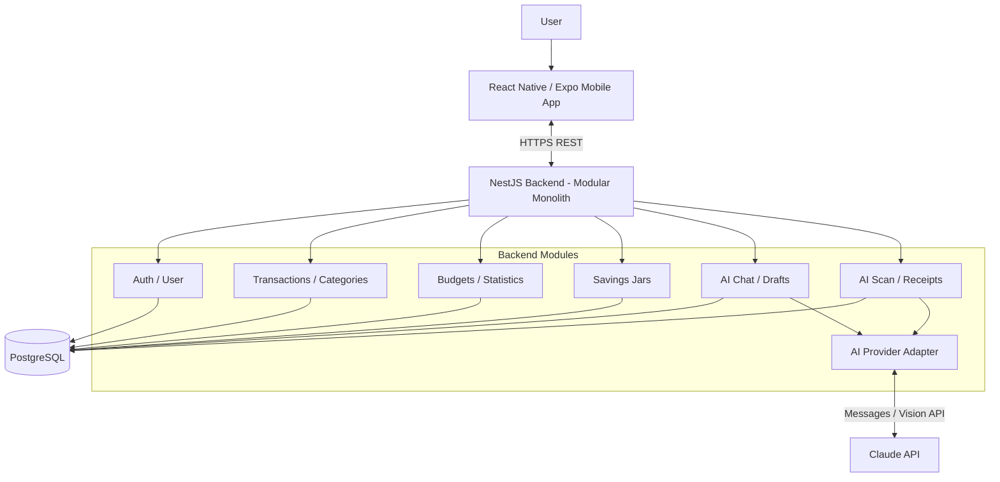
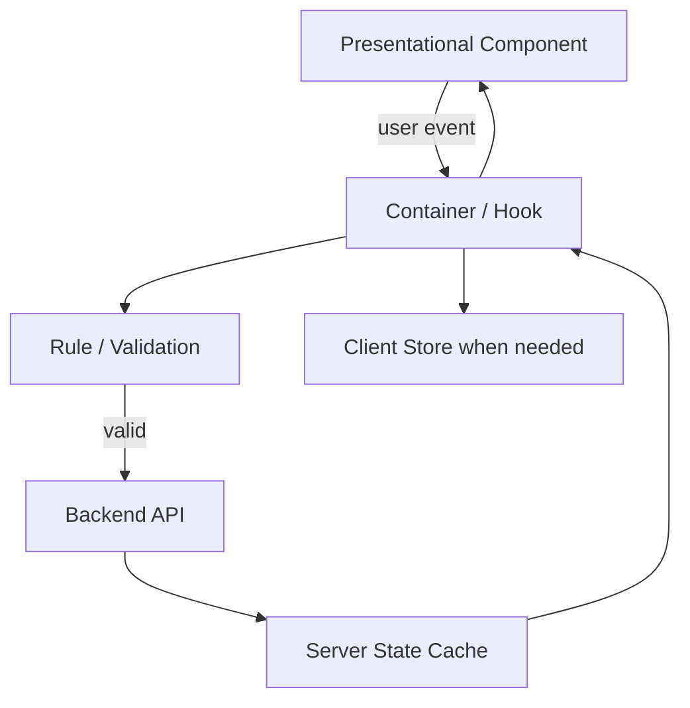

# SOLUTION ARCHITECTURE
## Quản Lý Chi Tiêu – AI Smart Expense

- **Document ID:** QLCT-ARCH-001
- **Version:** 1.1 (synced with approved Review Plan v1.1)
- **Architecture style:** Modular Monolith

## 1. Goals and constraints

- Native mobile experience targeting Android and iOS.
- Mobile app communicates only with backend REST APIs.
- Backend owns business rules, authorization, persistence and AI-provider access.
- AI output is untrusted input and remains a draft until the user confirms.
- PostgreSQL is the authoritative source for financial records.
- Receipt images are temporary processing data and are not retained long term.
- Avoid microservices and unnecessary infrastructure for v1.

## 2. Approved technology direction

| Layer | Technology | Responsibility |
|---|---|---|
| Mobile | React Native + Expo + TypeScript | Android/iOS UI and user interactions |
| Backend | Node.js + NestJS + TypeScript | REST API and business modules |
| Database | PostgreSQL | Durable financial and application data |
| ORM/migrations | Prisma ORM | Data access and schema migration |
| AI | Claude API via backend adapter | Natural language parsing and receipt image analysis |
| Transport | REST + HTTPS + JSON; multipart for image upload | Mobile/backend communication |
| Authentication | Short-lived access token + refresh-session flow | Authentication and session control |

The exact patch versions, hosting provider, deployment region and package versions are to be resolved at bootstrap/release. Use mutually compatible stable supported versions and commit lockfiles; do not auto-upgrade major versions during implementation. A monorepo (`apps/mobile`, `apps/api`, `packages/contracts`, `docs`) and pnpm workspace are recommended for v1, but repository bootstrap must record the final decision. GitHub Actions is the recommended CI candidate; Hosting and deployment region can remain open until release planning.

## 3. High-level architecture

The diagram is logical. NestJS modules are deployed together as one backend service in v1; they are not separate microservices.

## 4. Backend module responsibilities

| Module | Responsibilities |
|---|---|
| Auth | Registration, login, refresh, logout, session revocation |
| User | Current-user profile and ownership context |
| Category | Per-user default and custom categories |
| Transaction | Manual and confirmed AI transactions; list/detail/edit/delete |
| Budget | Monthly limits, spending calculations and threshold alerts |
| SavingJar | Jar creation, deposits, withdrawals and transfer history; no rename/target-edit/delete endpoints in v1 (D-11) |
| Statistics | Derived financial summaries and chart series |
| AIChat | Conversations, messages, context assembly, draft batches and confirmation |
| AIScan | Upload validation, temporary image processing, receipt draft and item rows |
| AIProvider | Provider abstraction, request/response normalization, timeouts, error mapping |

## 5. Frontend architecture and ECC

Apply separation of concerns, using the Rule + Store + Container + Presentational pattern in a way appropriate to React Native.

### Rule
- Pure business rules and validation functions independent of UI and persistence.
- Examples: positive-money validation, available-balance formula, budget usage calculation, receipt item-sum reconciliation, draft confirmability.
- Rules should be independently unit-testable.

### Store
- Own client-side state that is genuinely shared across screens/components (e.g. session UI state, current draft editor state, temporary filters).
- Keep server state distinct from client state. A server-state library may be used for API cache, loading, invalidation and refetching.
- Avoid duplicating the database/server as a second source of truth in a global client store.
- Zustand and TanStack Query are recommended candidates, not product decisions; confirm package compatibility during P0 bootstrap and pin exact versions in the lockfile.

### Container
- Screen-level/container components and custom hooks coordinate API requests, side effects, store state, loading/error handling and callbacks.
- Pass prepared data and event handlers to presentational components.

### Presentational components
- Render UI from props and emit user events.
- Do not own business rules, database access or direct backend API calls.

Example flow:

Do not force the frontend Container pattern onto backend code. Backend separation of concerns is described below.

## 6. Backend layering

Use NestJS modules with clear boundaries, generally separating:
- Controller: HTTP parsing, authentication context, DTO validation and response mapping.
- Application service/use case: orchestrates workflows and database transactions.
- Domain rules: financial calculations and invariants, preferably pure where practical.
- Repository/data-access: Prisma queries and persistence boundaries.
- Provider adapter: isolates Claude-specific API details from business modules.

Do not put business logic in controllers or call Claude directly from controllers.

## 7. AI Chat flow

1. Mobile sends a user message to the authenticated backend conversation endpoint.
2. Backend validates ownership and request limits.
3. Backend assembles conversation context and relevant permitted financial/category context.
4. AIProvider calls Claude Messages API.
5. Backend parses the structured result, validates schema and treats model output as untrusted.
6. Backend creates an AI draft batch and individual drafts; it does not create transactions.
7. Mobile shows editable drafts and validation state.
8. User confirms one draft or all eligible pending drafts.
9. Backend re-validates and creates transactions in a database transaction; draft state is updated atomically.

## 8. AI Scan flow

1. User selects an image on the device.
2. Mobile uploads it to the authenticated scan endpoint as multipart data.
3. Backend checks content type, file signature, size and decodeability.
4. Backend may resize/compress and forwards the image to Claude Vision using a bounded in-memory/temporary processing path.
5. Backend normalizes merchant/date/items/total and creates one receipt draft with child draft-item rows.
6. Temporary image bytes/files are discarded after success, failure or cancellation. No receipt image is written to permanent database/object storage or logs.
7. User chooses category, corrects data and reconciles item sum to receipt total.
8. At confirmation, backend locks/serializes the user's balance-changing operations, checks projected available balance is non-negative, and atomically creates one expense transaction, receipt details and receipt item rows. If funds are insufficient or reconciliation fails, it creates no financial record and retains the draft for correction/retry.

A cleanup mechanism is required for abnormal termination when temporary disk storage is used. Prefer memory streaming/bounded temporary handling if the chosen runtime supports it safely.

## 9. Data and consistency rules

- PostgreSQL is the source of truth.
- Every user-owned record is scoped by authenticated user ID.
- Do not trust a client-supplied user_id for authorization.
- Available balance is derived from recorded income, expenses and jar transfer history; no opening balance.
- Jar current balance is derived from deposits minus withdrawals; budget spent amount is derived from expense transactions.
- Invoice transaction and receipt child rows commit atomically.
- Confirm-all validates every pending draft in the batch before inserting any transaction. If an invalid pending draft exists, insert none in that attempt.
- Previously confirmed/cancelled drafts are not recreated by later confirm-all requests.
- Financial mutations require idempotency and concurrency control to prevent duplicate writes or overdrafts.
- **Group-approved D-07:** available balance must never become negative. Validate the projected result after manual expense creation, transaction update/delete, jar deposit/withdrawal, jar creation with initial deposit, individual AI-draft confirmation, confirm-all and AI Scan confirmation.
- **Recommended concurrency implementation:** acquire a lock on the owning `users` row as the first step inside the PostgreSQL transaction for every balance-affecting mutation; compute the projected balance after obtaining the lock; reject and roll back if it is below zero. A tested serializable strategy with retry handling may be substituted if it provides the same invariant. All code paths must use one shared balance-mutation service/protocol.
- **Receipt edit invariant (D-06):** when a confirmed receipt transaction is edited, any changed total and receipt-item rows must be updated in the same database transaction; `transactions.amount` must equal the sum of `receipt_items.amount` at commit.
- **Savings jar scope (D-11):** no jar rename, target edit or delete in v1.
- **Idempotency recommendation (D-05):** scope keys by authenticated user and operation; same key + same request fingerprint returns the original result, while same key + different request fingerprint returns a conflict. Resource-level columns/unique constraints are preferred over a new general-purpose table; the proposed schema delta is explicitly documented in ERD v1.1 and must be reviewed before migration.

## 10. Security and privacy

- HTTPS only in deployed environments.
- Hash passwords with a modern password-hashing algorithm; never store plaintext passwords.
- Store refresh-token hashes and revoke sessions on logout.
- Keep Claude API keys in backend secret management, never in the mobile application.
- Authorize each record access by owner.
- Validate all DTOs and AI outputs on backend.
- Apply rate/size limits to AI and image endpoints.
- Redact secrets and sensitive data from logs.
- Do not log receipt image content; do not persist original receipt images.

## 11. Environments and deployment

Three logical environments:
- Development: local development and developer test data.
- Testing: repeatable integration/E2E and acceptance testing.
- Production: released application and production data.

Initial deployment shape: one mobile app, one backend API service, one PostgreSQL database and outbound AI provider connection. Redis, microservices and dedicated image object storage are not required by default for v1; introduce only when a demonstrated need exists.

## 12. Testing strategy

- Frontend unit tests: pure rules, validators, formatting and state transitions.
- Backend unit tests: domain rules, services and validators.
- Integration tests: repositories/Prisma against a test database, API modules and AI-provider adapter using controlled mocks.
- E2E tests: critical user journeys across mobile/API, including auth, manual transaction, budget, jar transfer, AI draft confirmation and receipt scan confirmation.
- External AI calls must be mocked or fixture-driven in automated tests; do not make the test suite depend on a live provider call.
- Add integration tests for concurrent expense creation versus jar deposit, transaction edit/delete balance invariant, individual/confirm-all AI draft balance checks, and receipt edit reconciliation.
- A live-provider smoke test may be run manually in a controlled environment; it is not part of deterministic CI.

## 13. Architecture decisions and assumptions still open

- Hosting provider and deployment region (defer until release planning).
- Exact stable dependency versions and final frontend state/server-state packages (verify compatibility at P0 bootstrap).
- Runtime temporary image strategy and upload size limit (OQ-08).
- AI model ID, timeouts, retry policy and cost/rate limits (configure outside source code; finalize before live AI integration).
- Backup/restore strategy, retention period and restore verification (before production).
- Budget rollover behavior (OQ-11) and future transaction-date policy (OQ-10) remain product assumptions/open questions; do not turn defaults into approved requirements without a change decision.
- Physical transaction deletion strategy (hard vs soft) remains a technical gate before migration; user-visible FR-07 behavior is already approved.

**Decision status:** D-06, D-07, D-10, D-11 and D-12 reflect group-confirmed behavior. D-02…D-05, D-08…D-09, D-13…D-17 are technical recommendations/defaults in the approved Review Plan, not new product requirements. D-20 retention/backup sub-policies remain open. These are implementation-planning decisions, not a reason to change the approved high-level architecture.
