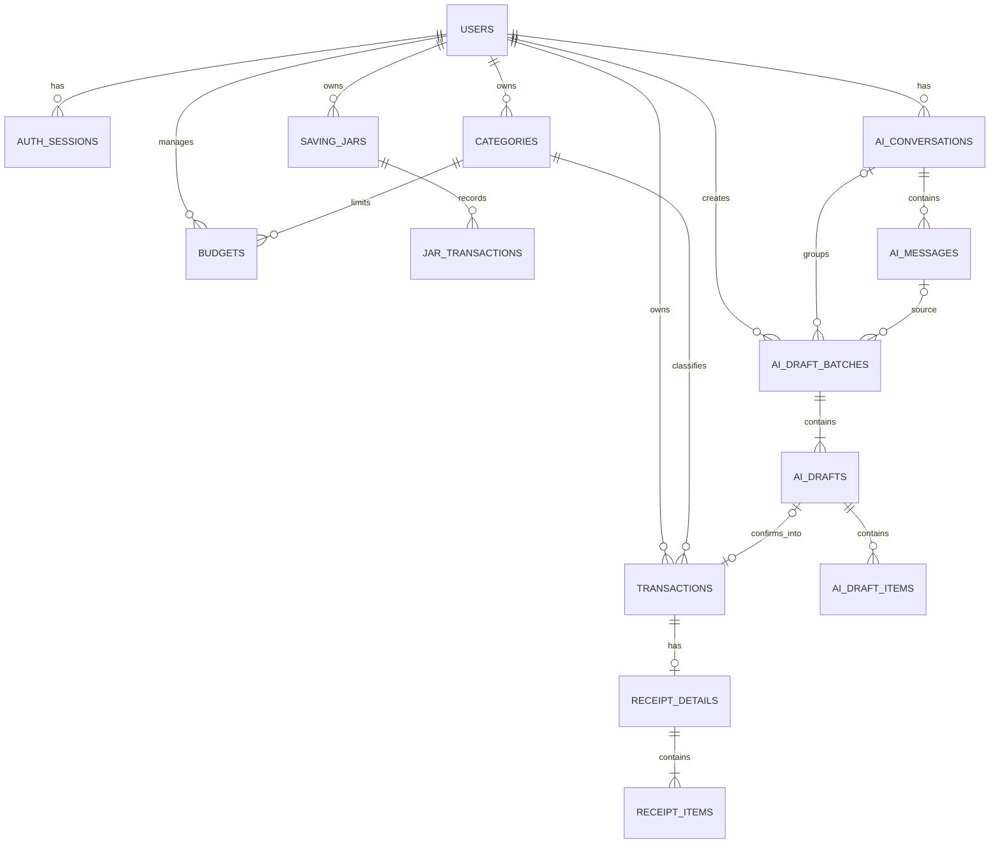

# DATABASE SCHEMA / ERD
## Quản Lý Chi Tiêu – AI Smart Expense

- **Document ID:** QLCT-DB-001
- **Version:** 1.1 (synchronized logical schema; proposed idempotency delta requires migration review)
- **DBMS:** PostgreSQL
- **ORM:** Prisma
- **Table count:** 14 logical tables

> This file is the synchronized logical schema for the 14-table baseline. D-05 adds proposed resource-level idempotency columns without adding a 15th table; those physical deltas must be reviewed in the generated Prisma migration before execution. Validate composite ownership foreign keys, deletion rules, indexes and transaction boundaries. Do not silently add/remove entities or weaken approved business invariants.

## 1. ER Diagram

## 2. Conventions

- Primary keys: UUID.
- Money: PostgreSQL `BIGINT`, positive integer VND; API represents amounts as decimal strings to avoid JavaScript precision issues.
- Date-only business date: `DATE`.
- Event timestamps: `TIMESTAMPTZ`, stored in UTC and presented in Asia/Ho_Chi_Minh.
- Enums: `INCOME/EXPENSE`, `MANUAL/AI_CHAT/AI_SCAN`, `DEPOSIT/WITHDRAW`, draft statuses listed below.
- All owner-scoped records include `user_id` where relevant.
- All `created_at` and `updated_at` defaults/updates are managed consistently.
- Idempotency values are stored with an operation namespace (for example `transactions.create:<client-key>` or `jar_transactions.deposit:<client-key>`). Unique constraints are scoped by owner and resource/operation; `*_request_hash` stores SHA-256 of the normalized request payload. For image scan requests, calculate the image fingerprint in a bounded streaming/in-memory path and discard image bytes after processing.

## 3. Tables

### 3.1 `users`

| Column | Type | Constraints / meaning |
|---|---|---|
| id | UUID | PK |
| full_name | VARCHAR | NOT NULL |
| email | VARCHAR | NOT NULL, unique after normalization |
| password_hash | VARCHAR | NOT NULL |
| phone | VARCHAR | NULL |
| terms_accepted_at | TIMESTAMPTZ | NOT NULL |
| created_at | TIMESTAMPTZ | NOT NULL |
| updated_at | TIMESTAMPTZ | NOT NULL |

### 3.2 `auth_sessions`

| Column | Type | Constraints / meaning |
|---|---|---|
| id | UUID | PK |
| user_id | UUID | FK users, NOT NULL |
| refresh_token_hash | VARCHAR | NOT NULL; never store raw refresh token |
| expires_at | TIMESTAMPTZ | NOT NULL |
| revoked_at | TIMESTAMPTZ | NULL |
| created_at | TIMESTAMPTZ | NOT NULL |

Index `user_id`; consider unique token hash. Session rotation/revocation policy is implemented in Auth.

### 3.3 `categories`

| Column | Type | Constraints / meaning |
|---|---|---|
| id | UUID | PK |
| user_id | UUID | FK users, NOT NULL |
| name | VARCHAR | NOT NULL |
| name_normalized | VARCHAR | NOT NULL; duplicate detection |
| type | ENUM | INCOME or EXPENSE |
| is_default | BOOLEAN | NOT NULL |
| created_at | TIMESTAMPTZ | NOT NULL |

Unique `(user_id, type, name_normalized)`. Default categories are provisioned per user at registration. No rename/delete endpoint in v1.

### 3.4 `transactions`

| Column | Type | Constraints / meaning |
|---|---|---|
| id | UUID | PK |
| user_id | UUID | FK users, NOT NULL |
| category_id | UUID | FK categories, NOT NULL |
| type | ENUM | INCOME or EXPENSE |
| amount | BIGINT | NOT NULL, CHECK > 0 |
| transaction_date | DATE | NOT NULL |
| note | TEXT | NULL |
| source | ENUM | MANUAL, AI_CHAT, AI_SCAN |
| idempotency_key | VARCHAR | NULL; request deduplication key scoped to user+operation |
| idempotency_request_hash | CHAR(64) | NULL; fingerprint of normalized request payload for same-key/different-payload detection |
| created_at | TIMESTAMPTZ | NOT NULL |
| updated_at | TIMESTAMPTZ | NOT NULL |

Required invariants: category must belong to the same user; category type must match transaction type. Enforce owner-scoped references using composite unique keys/FKs or equivalent transactional backend checks plus DB constraints where possible. Unique `(user_id, idempotency_key)` when key is non-null. If the same key is replayed with the same request hash, return the original result; if the hash differs, reject with an idempotency conflict.

### 3.5 `budgets`

| Column | Type | Constraints / meaning |
|---|---|---|
| id | UUID | PK |
| user_id | UUID | FK users, NOT NULL |
| category_id | UUID | FK categories, NOT NULL; EXPENSE only |
| month_start | DATE | NOT NULL; first day of month |
| limit_amount | BIGINT | NOT NULL, CHECK > 0 |
| created_at | TIMESTAMPTZ | NOT NULL |
| updated_at | TIMESTAMPTZ | NOT NULL |

Unique `(user_id, category_id, month_start)`. Spent amount is derived from expense transactions, not stored.

### 3.6 `saving_jars`

| Column | Type | Constraints / meaning |
|---|---|---|
| id | UUID | PK |
| user_id | UUID | FK users, NOT NULL |
| name | VARCHAR | NOT NULL |
| target_amount | BIGINT | NOT NULL, CHECK > 0 |
| create_idempotency_key | VARCHAR | NULL; deduplicates jar creation request |
| create_request_hash | CHAR(64) | NULL; detects key reuse with a different payload |
| created_at | TIMESTAMPTZ | NOT NULL |
| updated_at | TIMESTAMPTZ | NOT NULL |

Do not store a duplicated current balance in v1; derive from jar transaction history. v1 does not support jar rename, target edit or delete (D-11). Unique `(user_id, create_idempotency_key)` when non-null.

### 3.7 `jar_transactions`

| Column | Type | Constraints / meaning |
|---|---|---|
| id | UUID | PK |
| user_id | UUID | FK users, NOT NULL |
| jar_id | UUID | FK saving_jars, NOT NULL |
| type | ENUM | DEPOSIT or WITHDRAW |
| amount | BIGINT | NOT NULL, CHECK > 0 |
| transaction_date | TIMESTAMPTZ | NOT NULL |
| note | TEXT | NULL |
| idempotency_key | VARCHAR | NULL; request deduplication key scoped to user+operation |
| idempotency_request_hash | CHAR(64) | NULL; request fingerprint for replay validation |

Unique `(user_id, idempotency_key)` when non-null. `jar_id` must belong to the same user. Validate available balance / jar balance atomically with proper concurrency control.

### 3.8 `ai_conversations`

| Column | Type | Constraints / meaning |
|---|---|---|
| id | UUID | PK |
| user_id | UUID | FK users, NOT NULL |
| title | VARCHAR | NULL |
| is_saved | BOOLEAN | NOT NULL, default false |
| saved_at | TIMESTAMPTZ | NULL |
| created_at | TIMESTAMPTZ | NOT NULL |
| updated_at | TIMESTAMPTZ | NOT NULL |

Only saved conversations appear in the saved-history list. Unsaved conversation retention is OQ-09.

### 3.9 `ai_messages`

| Column | Type | Constraints / meaning |
|---|---|---|
| id | UUID | PK |
| conversation_id | UUID | FK ai_conversations, NOT NULL |
| role | ENUM | USER or ASSISTANT |
| content | TEXT | NOT NULL |
| idempotency_key | VARCHAR | NULL; deduplicates user-message submission (USER role) |
| idempotency_request_hash | CHAR(64) | NULL; request fingerprint |
| created_at | TIMESTAMPTZ | NOT NULL |

Index `(conversation_id, created_at)`. For user-submitted messages, unique `(conversation_id, idempotency_key)` when key is non-null; assistant messages do not require a client idempotency key.

### 3.10 `ai_draft_batches`

| Column | Type | Constraints / meaning |
|---|---|---|
| id | UUID | PK |
| user_id | UUID | FK users, NOT NULL |
| conversation_id | UUID | Nullable FK ai_conversations; null for standalone AI Scan |
| source_message_id | UUID | Nullable FK ai_messages; typically AI Chat source message |
| source_type | ENUM | AI_CHAT or AI_SCAN |
| idempotency_key | VARCHAR | NULL; deduplicates AI processing request (AI_SCAN or batch creation) |
| idempotency_request_hash | CHAR(64) | NULL; normalized request fingerprint |
| confirm_all_idempotency_key | VARCHAR | NULL; deduplicates confirm-all action |
| confirm_all_request_hash | CHAR(64) | NULL; confirm-all request fingerprint |
| created_at | TIMESTAMPTZ | NOT NULL |

The batch groups drafts created from one AI processing request. For one Chat message with multiple transactions, one batch contains multiple drafts. AI Scan generally creates one batch with one receipt draft. Unique `(user_id, source_type, idempotency_key)` when non-null; unique `(user_id, confirm_all_idempotency_key)` when non-null. Same key + same request hash replays the prior result; same key + different hash conflicts.

### 3.11 `ai_drafts`

| Column | Type | Constraints / meaning |
|---|---|---|
| id | UUID | PK |
| user_id | UUID | FK users, NOT NULL |
| batch_id | UUID | FK ai_draft_batches, NOT NULL |
| transaction_type | ENUM | Nullable until known; INCOME or EXPENSE |
| amount | BIGINT | Nullable until completed; if set must be > 0 |
| category_id | UUID | Nullable until user selects a valid category |
| transaction_date | DATE | Nullable until known/validated |
| note | TEXT | NULL |
| merchant_name | VARCHAR | NULL; receipt merchant |
| status | ENUM | NEEDS_INPUT, READY, CONFIRMED, CANCELLED, EXPIRED |
| validation_errors | JSONB | NULL; machine-readable missing/invalid fields |
| transaction_id | UUID | Nullable FK transactions; UNIQUE when not null |
| confirm_idempotency_key | VARCHAR | NULL; deduplicates individual confirmation |
| confirm_request_hash | CHAR(64) | NULL; request fingerprint for individual confirmation |
| expires_at | TIMESTAMPTZ | NULL; governed by OQ-07 |
| created_at | TIMESTAMPTZ | NOT NULL |
| updated_at | TIMESTAMPTZ | NOT NULL |

A confirmed draft points to at most one transaction. Unique `(user_id, confirm_idempotency_key)` when non-null. A confirmed draft's unique `transaction_id` and status transition also protect against duplicate confirmation. Deleting a conversation deletes pending/unconfirmed drafts but must not delete already confirmed transactions. Use FK `ON DELETE SET NULL` from draft to transaction if a transaction is deleted, and cascade conversation → messages/batches → drafts only where it cannot cascade into confirmed transaction rows. Implement deletion in an explicit transaction with status-aware logic.

### 3.12 `ai_draft_items`

| Column | Type | Constraints / meaning |
|---|---|---|
| id | UUID | PK |
| draft_id | UUID | FK ai_drafts, NOT NULL |
| item_name | VARCHAR | Nullable while unreadable; required to confirm |
| amount | BIGINT | Nullable while unreadable; if set must be > 0 |
| sort_order | INTEGER | NOT NULL |

Used for draft receipt line items. Not used for ordinary Chat drafts. Index `(draft_id, sort_order)`.

### 3.13 `receipt_details`

| Column | Type | Constraints / meaning |
|---|---|---|
| id | UUID | PK |
| transaction_id | UUID | FK transactions, NOT NULL, UNIQUE |
| merchant_name | VARCHAR | NULL |
| created_at | TIMESTAMPTZ | NOT NULL |

One confirmed receipt transaction has at most one receipt details record. Receipt date/total are represented by the parent transaction's date/amount.

### 3.14 `receipt_items`

| Column | Type | Constraints / meaning |
|---|---|---|
| id | UUID | PK |
| receipt_detail_id | UUID | FK receipt_details, NOT NULL |
| item_name | VARCHAR | NOT NULL |
| amount | BIGINT | NOT NULL, CHECK > 0 |
| sort_order | INTEGER | NOT NULL |

Index `(receipt_detail_id, sort_order)`.

## 4. Derived calculations

- `available_balance = SUM(INCOME transactions) - SUM(EXPENSE transactions) - SUM(DEPOSIT jar_transactions) + SUM(WITHDRAW jar_transactions)` for the user.
- `jar_balance = SUM(DEPOSIT) - SUM(WITHDRAW)` for a jar.
- `budget_spent = SUM(EXPENSE transactions)` for the budget category and month.
- Internal jar transfers never enter income/expense totals or budget usage.
- `monthly_net_change = monthly_income - monthly_expense`.
- **D-07 invariant:** available balance after every committed balance-affecting mutation must be `>= 0`. A user with zero or insufficient available balance cannot create/confirm an expense or deposit to a jar if the projected result would be negative.

Do not create a second authoritative balance field unless a later performance design introduces a reconciled ledger/projection with integrity controls and explicit approval.

## 5. Critical constraints and transaction boundaries

- Positive money constraints at database and DTO/domain levels.
- Owner isolation: referenced category/jar/conversation/draft must belong to the same authenticated user.
- Unique email and normalized per-user category name.
- Unique budget per user/category/month.
- At most one transaction linked from a draft.
- At most one receipt_details row per transaction.
- One transaction + receipt_details + all receipt_items saved atomically.
- Confirm-all: lock/read pending drafts consistently, validate the entire pending set, then create all transaction records and mark drafts confirmed in one transaction. If any pending draft is invalid, create none in that attempt.
- **All balance-changing mutations:** transaction create/update/delete, jar create with initial deposit, jar deposit/withdrawal, individual draft confirmation, confirm-all and receipt confirmation must acquire the same per-user concurrency guard before reading derived balance. Recommended v1 strategy: inside a PostgreSQL transaction, lock the owning `users` row (`SELECT ... FOR UPDATE`) first; compute projected balance from committed ledger rows plus the proposed mutation(s); reject and roll back if projected balance is negative; otherwise persist. All code paths must follow this protocol. A serializable strategy with bounded retry may replace it only if tests prove equivalent behavior.
- **Confirm-all:** lock user and pending drafts consistently, validate every pending draft, compute the combined projected balance, then create all transactions and update draft statuses in one DB transaction. If any draft is invalid or projected balance is negative, create none in that attempt.
- **Receipt reconciliation:** before create/update/confirm commit, `transactions.amount` must equal the sum of associated `receipt_items.amount`; use service/domain validation inside the same DB transaction (a normal CHECK constraint cannot validate child-row aggregates).
- Idempotency keys should be unique per authenticated user and operation scope for retryable mutations; compare stored request hash on replay. Resource-level columns are the v1 recommendation; no 15th idempotency table is added in this plan.

## 6. Index recommendations

- `users(email)` UNIQUE.
- `transactions(user_id, transaction_date)`.
- `transactions(user_id, category_id, transaction_date)`.
- `budgets(user_id, month_start)` plus unique user/category/month.
- `jar_transactions(jar_id, transaction_date)`.
- `ai_messages(conversation_id, created_at)`.
- `ai_drafts(batch_id, status)`.
- `receipt_items(receipt_detail_id, sort_order)`.

## 7. Deletion and retention

- FR-07 user-visible transaction deletion requires explicit confirmation and recalculation of available balance, budget and statistics. Hard delete versus soft delete remains an implementation decision under OQ-01; choose before migration and ensure deleted records are excluded from all aggregates.
- If hard deletion is selected, delete dependent receipt_details/receipt_items atomically with the parent transaction. If soft deletion is selected, preserve dependent rows but exclude the parent and its children from active views/aggregates. Do not orphan receipt rows.
- Deleting an AI conversation removes messages and unconfirmed drafts/batches, but never deletes confirmed transactions.
- Do not store receipt image bytes, image URL or permanent file key in these tables.
- Draft retention and unsaved conversation cleanup remain OQ-07/OQ-09.
- Account deletion/backups remain OQ-03/OQ-06.

## 8. Logical schema review tasks

During Planning, explicitly review:
1. Composite owner-scoped foreign keys vs equivalent guaranteed service validation.
2. Exact enum and nullability implementation in Prisma.
3. FK on-delete actions to preserve confirmed transactions when a conversation is deleted.
4. Idempotency key scope and persistence for transaction and jar transfer endpoints.
5. Concurrent balance protection for jar deposits/withdrawals.
6. Query performance and explain plans for dashboard/history/statistics.
7. Whether soft deletion is required by the account/data retention policy (OQ-01; decide before migration).
8. Confirm resource-level idempotency column/unique-index names and migration SQL for D-05.
9. Ensure every balance mutation uses the shared per-user lock protocol and has concurrency integration tests (D-07).
10. Ensure no saving-jar PATCH/DELETE endpoint or mutation task exists in v1 (D-11).
